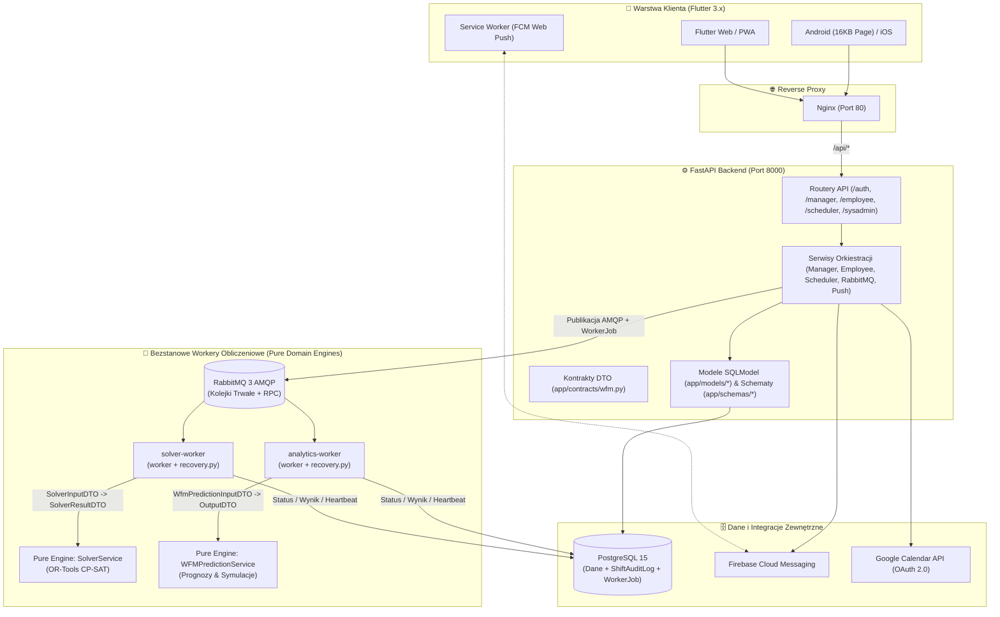
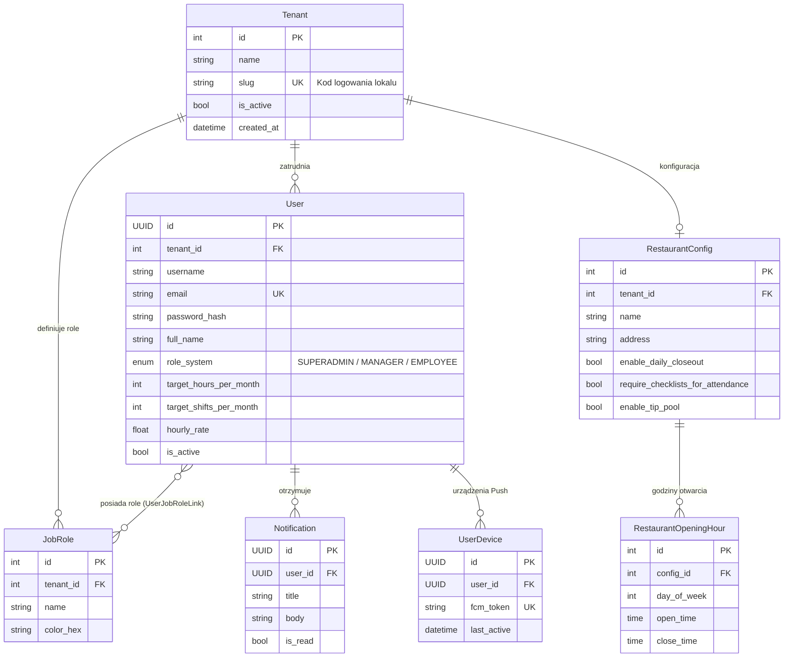
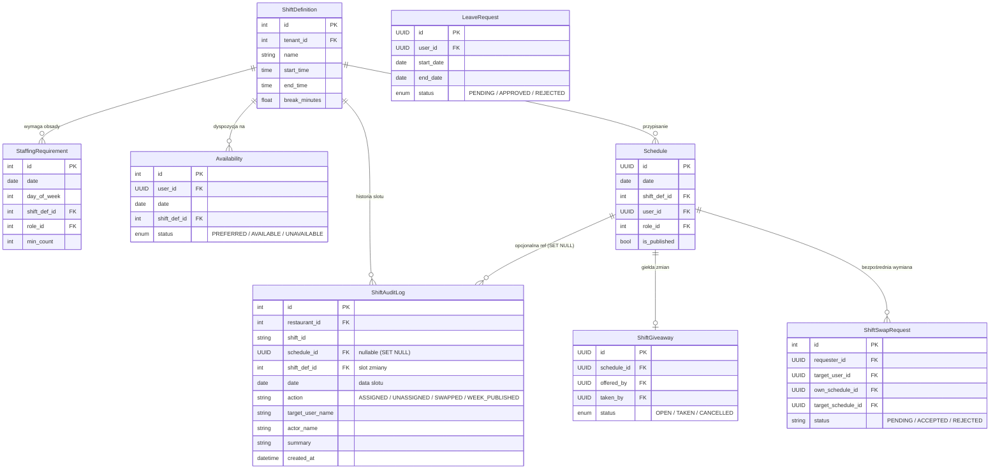
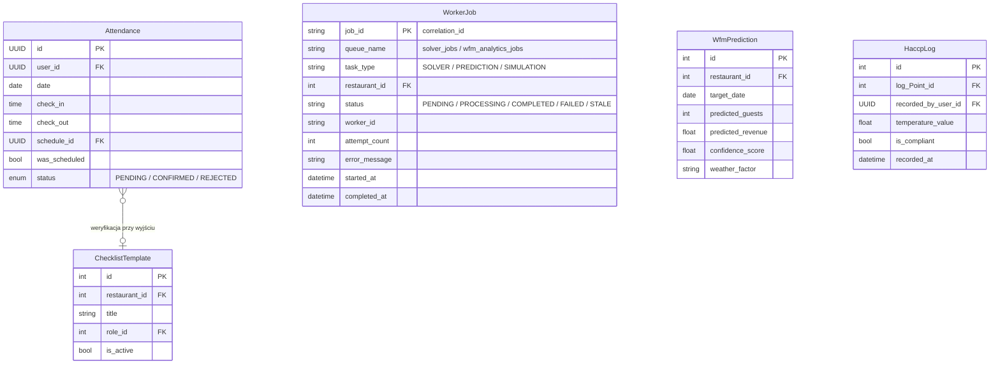
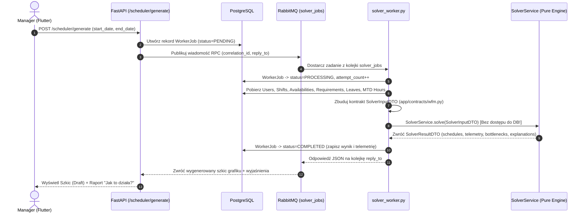
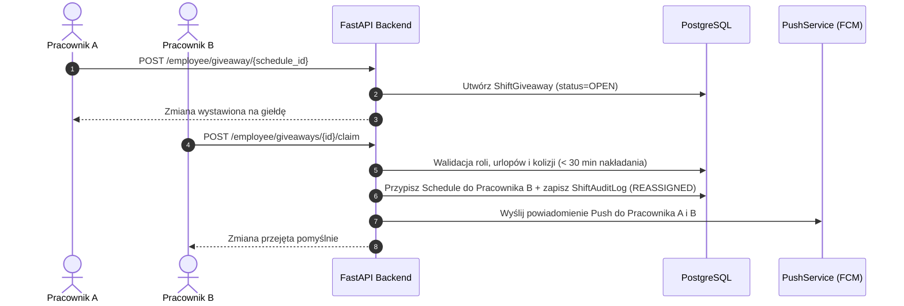

# Architektura Systemu — PlannerV2 (v2.2.4)

## Przegląd

PlannerV2 to wielodostępny (Multi-Tenant) system klasy **Workforce Management (WFM)** dla gastronomii z bezstanowymi silnikami obliczeniowymi AI/OR-Tools CP-SAT, niezawodną kolejką zadań RabbitMQ, audytem zmian per slot, rozliczeniem godzin miesięcznych (przepracowanych i zaplanowanych) oraz powiadomieniami Web/Mobile Push.

> [!TIP]
> **Wygodne przeglądanie i powiększanie diagramów na GitHubie:**
> 1. Pod każdym diagramem znajduje się bezpośredni przycisk **🔍 Otwórz pełnoekranowy diagram SVG (Zoom / Ctrl+Scroll)**, który otwiera wektorowy diagram w osobnej karcie przeglądarki z obsługą nieskończonego powiększania.
> 2. Wielki diagram bazy danych został podzielony na **3 czytelne diagramy domenowe**, dzięki czemu czcionki są duże i ostre bezpośrednio na stronie.
> 3. Pod każdym diagramem dostępny jest również rozwijany **schemat tekstowy ASCII / tabela relacji**, które powiększają się natywnie wraz ze stroną (`Ctrl` + `+`).

---

## 1. Diagram Komponentów i Przepływu Danych

**[🔍 Otwórz pełnoekranowy diagram komponentów SVG (Zoom / Ctrl+Scroll)](https://mermaid.ink/svg/eyJjb2RlIjogImZsb3djaGFydCBURFxuICAgIHN1YmdyYXBoIENsaWVudFtcIlx1ZDgzZFx1ZGNmMSBXYXJzdHdhIEtsaWVudGEgKEZsdXR0ZXIgMy54KVwiXVxuICAgICAgICBXRUJbXCJGbHV0dGVyIFdlYiAvIFBXQVwiXVxuICAgICAgICBNT0JbXCJBbmRyb2lkICgxNktCIFBhZ2UpIC8gaU9TXCJdXG4gICAgICAgIFNXW1wiU2VydmljZSBXb3JrZXIgKEZDTSBXZWIgUHVzaClcIl1cbiAgICBlbmRcblxuICAgIHN1YmdyYXBoIEVkZ2VbXCJcdWQ4M2NcdWRmMTAgUmV2ZXJzZSBQcm94eVwiXVxuICAgICAgICBOR0lOWFtcIk5naW54IChQb3J0IDgwKVwiXVxuICAgIGVuZFxuXG4gICAgc3ViZ3JhcGggQmFja2VuZFtcIlx1MjY5OVx1ZmUwZiBGYXN0QVBJIEJhY2tlbmQgKFBvcnQgODAwMClcIl1cbiAgICAgICAgUk9VVEVSU1tcIlJvdXRlcnkgQVBJICgvYXV0aCwgL21hbmFnZXIsIC9lbXBsb3llZSwgL3NjaGVkdWxlciwgL3N5c2FkbWluKVwiXVxuICAgICAgICBTRVJWSUNFU1tcIlNlcndpc3kgT3JraWVzdHJhY2ppIChNYW5hZ2VyLCBFbXBsb3llZSwgU2NoZWR1bGVyLCBSYWJiaXRNUSwgUHVzaClcIl1cbiAgICAgICAgQ09OVFJBQ1RTW1wiS29udHJha3R5IERUTyAoYXBwL2NvbnRyYWN0cy93Zm0ucHkpXCJdXG4gICAgICAgIE1PREVMU1tcIk1vZGVsZSBTUUxNb2RlbCAoYXBwL21vZGVscy8qKSAmIFNjaGVtYXR5IChhcHAvc2NoZW1hcy8qKVwiXVxuICAgIGVuZFxuXG4gICAgc3ViZ3JhcGggQXN5bmNXb3JrZXJzW1wiXHVkODNkXHVkZTgwIEJlenN0YW5vd2UgV29ya2VyeSBPYmxpY3plbmlvd2UgKFB1cmUgRG9tYWluIEVuZ2luZXMpXCJdXG4gICAgICAgIFJNUVsoXCJSYWJiaXRNUSAzIEFNUVBcXG4oS29sZWpraSBUcndhXHUwMTQyZSArIFJQQylcIildXG4gICAgICAgIFNPTFZFUl9XW1wic29sdmVyLXdvcmtlclxcbih3b3JrZXIgKyByZWNvdmVyeS5weSlcIl1cbiAgICAgICAgU09MVkVSX0VbXCJQdXJlIEVuZ2luZTogU29sdmVyU2VydmljZVxcbihPUi1Ub29scyBDUC1TQVQpXCJdXG4gICAgICAgIFdGTV9XW1wiYW5hbHl0aWNzLXdvcmtlclxcbih3b3JrZXIgKyByZWNvdmVyeS5weSlcIl1cbiAgICAgICAgV0ZNX0VbXCJQdXJlIEVuZ2luZTogV0ZNUHJlZGljdGlvblNlcnZpY2VcXG4oUHJvZ25venkgJiBTeW11bGFjamUpXCJdXG4gICAgZW5kXG5cbiAgICBzdWJncmFwaCBTdG9yYWdlW1wiXHVkODNkXHVkZGM0XHVmZTBmIERhbmUgaSBJbnRlZ3JhY2plIFpld25cdTAxMTl0cnpuZVwiXVxuICAgICAgICBQR1soXCJQb3N0Z3JlU1FMIDE1XFxuKERhbmUgKyBTaGlmdEF1ZGl0TG9nICsgV29ya2VySm9iKVwiKV1cbiAgICAgICAgRkNNW1wiRmlyZWJhc2UgQ2xvdWQgTWVzc2FnaW5nXCJdXG4gICAgICAgIEdDQUxbXCJHb29nbGUgQ2FsZW5kYXIgQVBJIChPQXV0aCAyLjApXCJdXG4gICAgZW5kXG5cbiAgICBXRUIgJiBNT0IgLS0-IE5HSU5YXG4gICAgU1cgPC4tPiBGQ01cbiAgICBOR0lOWCAtLT58XCIvYXBpLypcInwgUk9VVEVSU1xuICAgIFJPVVRFUlMgLS0-IFNFUlZJQ0VTXG4gICAgU0VSVklDRVMgLS0-IE1PREVMU1xuICAgIE1PREVMUyAtLT4gUEdcbiAgICBTRVJWSUNFUyAtLT58XCJQdWJsaWthY2phIEFNUVAgKyBXb3JrZXJKb2JcInwgUk1RXG4gICAgUk1RIC0tPiBTT0xWRVJfVyAmIFdGTV9XXG4gICAgU09MVkVSX1cgLS0-fFwiU29sdmVySW5wdXREVE8gLT4gU29sdmVyUmVzdWx0RFRPXCJ8IFNPTFZFUl9FXG4gICAgV0ZNX1cgLS0-fFwiV2ZtUHJlZGljdGlvbklucHV0RFRPIC0-IE91dHB1dERUT1wifCBXRk1fRVxuICAgIFNPTFZFUl9XICYgV0ZNX1cgLS0-fFwiU3RhdHVzIC8gV3luaWsgLyBIZWFydGJlYXRcInwgUEdcbiAgICBTRVJWSUNFUyAtLT4gRkNNICYgR0NBTCIsICJtZXJtYWlkIjogeyJ0aGVtZSI6ICJkZWZhdWx0In19)**



<details>
<summary>📐 <b>Alternatywny schemat tekstowy architektury (ASCII — łatwe powiększanie Ctrl++)</b></summary>

```text
+-----------------------------------------------------------------------------------+
|                        WARSTWA KLIENTA (Flutter 3.x)                              |
|   [Flutter Web / PWA]     [Android 16KB / iOS]     [Service Worker Web Push]      |
+-----------------------------------------+-----------------------------------------+
                                          | HTTPS / REST (JSON)
                                          v
+-----------------------------------------------------------------------------------+
|                           NGINX REVERSE PROXY (Port 80)                           |
|             / -> statyczny build Flutter Web   |   /api/* -> FastAPI :8000        |
+-----------------------------------------+-----------------------------------------+
                                          |
                                          v
+-----------------------------------------------------------------------------------+
|                         FASTAPI BACKEND (app/main.py)                             |
|  +-----------------------+  +------------------------+  +----------------------+  |
|  | Routery REST          |  | Serwisy Orkiestracji   |  | Kontrakty DTO        |  |
|  | - /auth, /sysadmin    |  | - SchedulerService     |  | app/contracts/wfm.py |  |
|  | - /manager, /employee |  | - ManagerService       |  | - SolverInputDTO     |  |
|  | - /scheduler          |  | - EmployeeService      |  | - SolverResultDTO    |  |
|  | - /api/notifications  |  | - RabbitMQService      |  | - WfmPrediction*DTO  |  |
|  +-----------------------+  +------------------------+  +----------------------+  |
|  +-----------------------------------------------------------------------------+  |
|  | Modularne Modele & Schematy: app/models/* oraz app/schemas/*                |  |
|  | (base, tenant, users, scheduling, operations, pos_legacy)                   |  |
|  +-----------------------------------------------------------------------------+  |
+-------------------+-------------------------------------------+-------------------+
                    | SQLModel / Alembic                        | AMQP RPC (aio-pika)
                    v                                           v
+---------------------------------------+   +---------------------------------------+
|         POSTGRESQL 15 DATABASE        |   |          RABBITMQ 3 BROKER            |
|  - Tenant, User, JobRole              |   |  - Kolejka: solver_jobs               |
|  - Schedule, ShiftAuditLog (per slot) |   |  - Kolejka: wfm_analytics_jobs        |
|  - Attendance, LeaveRequest           |<--+  - Rejestr stanu zadań: WorkerJob     |
|  - WorkerJob (śledzenie zadań AMQP)   |   +-------------------+-------------------+
+---------------------------------------+                       |
                                                                v
                                            +---------------------------------------+
                                            |   WORKERY + PURE DOMAIN ENGINES       |
                                            |  1. solver_worker.py + recovery.py    |
                                            |     -> SolverService (OR-Tools CP-SAT)|
                                            |        [Zero zależności od sesji DB]  |
                                            |  2. wfm_analytics_worker.py           |
                                            |     -> WFMPredictionService           |
                                            |        [Zero zależności od sesji DB]  |
                                            +---------------------------------------+
```

</details>

---

## 2. Architektura Pure Domain Engines i Kontraktów DTO

Silniki obliczeniowe WFM zostały całkowicie odizolowane od warstwy bazy danych (`SQLModel` / `Session`) i działają jako bezstanowe, deterministyczne silniki domenowe (**Pure Domain Engines**), gotowe do niezależnego skalowania:

| Komponent | Lokalizacja | Rola w architekturze |
|-----------|-------------|----------------------|
| **Kontrakty WFM DTO** | `backend/app/contracts/wfm.py` | Ścisłe modele Pydantic v2 definiujące wejście i wyjście obliczeń: `SolverInputDTO`, `SolverResultDTO`, `DecisionExplanationDTO`, `SolverWeightsDTO`, `WfmPredictionInputDTO`, `WfmPredictionOutputDTO`. |
| **Silnik CP-SAT** | `backend/app/services/solver.py` | Przyjmuje wyłącznie `SolverInputDTO` i zwraca `SolverResultDTO`. Wylicza optymalny grafik, telemetrię CP-SAT (`telemetry`), klasyfikację wąskich gardeł (`bottlenecks` przez `_classify_bottleneck_reason`) oraz szczegółowe wyjaśnienia decyzji dla każdego slotu (`decision_explanations`). |
| **Silnik Predykcji WFM** | `backend/app/services/wfm_prediction_service.py` | Przyjmuje `WfmPredictionInputDTO` i zwraca `WfmPredictionOutputDTO`. Oblicza prognozy ruchu gości, przychodów oraz wagi popytu bez otwierania połączeń do bazy danych. |
| **Warstwa Orkiestracji** | `backend/app/workers/solver_worker.py`, `wfm_analytics_worker.py`, `scheduler_service.py` | Odpowiada za pobranie encji z PostgreSQL, zbudowanie obiektów DTO, wywołanie czystego silnika obliczeniowego oraz zapis wyników, logów `ShiftAuditLog` i statusu `WorkerJob` w bazie danych. |

---

## 3. Modularna Struktura Pakietów i Zależności Backendu

### 3.1 Modele (`backend/app/models/`) i Schematy (`backend/app/schemas/`)
Monolityczne pliki modeli i schematów zostały rozdzielone na pakiety domenowe przy zachowaniu pełnej kompatybilności wstecznej eksportów w `__init__.py`:
- `base.py` — wyliczenia (`RoleSystem`, `AvailabilityStatus`, `LeaveStatus`, `AttendanceStatus`) oraz klasy bazowe.
- `tenant.py` — `Tenant`, `RestaurantConfig`, `RestaurantOpeningHour`.
- `users.py` — `User`, `JobRole`, `UserJobRoleLink`, `UserDevice`, `Notification`.
- `scheduling.py` — `ShiftDefinition`, `ShiftRoleLink`, `ShiftDefinitionDayLink`, `StaffingRequirement`, `Availability`, `Schedule`, `ShiftGiveaway`, `ShiftSwapRequest`, `LeaveRequest`, `ShiftAuditLog`.
- `operations.py` — `Attendance`, `WfmPrediction`, `WorkerJob`, `ChecklistTemplate`, `ChecklistItem`, `ChecklistExecution`, `HaccpLogPoint`, `HaccpLog`, `Announcement`, `PayrollRecord`.
- `pos_legacy.py` — odizolowane modele gastronomiczne POS/KDS (tymczasowo wyłączone z głównego kontekstu WFM).

### 3.2 Modularne Zależności Python (`backend/requirements/`)
Zależności podzielono na 3 wyspecjalizowane pliki, co odchudza obrazy kontenerów Docker:
- `backend/requirements/base.txt` — rdzeń: SQLModel, SQLAlchemy, Pydantic, Alembic, `psycopg2-binary`, `aio-pika`, narzędzia kryptograficzne i logowanie.
- `backend/requirements/api.txt` — `-r base.txt` + FastAPI, Uvicorn, `httpx`, integracje Google Calendar OAuth, Firebase Admin SDK (Push), ReportLab (eksport PDF) -> instalowane w `backend/Dockerfile`.
- `backend/requirements/worker.txt` — `-r base.txt` + `ortools` oraz biblioteki matematyczne wykorzystywane przez `solver-worker` -> instalowane w lekkim obrazie `backend/Dockerfile.solver`.
- `backend/requirements.txt` — agregator (`-r requirements/api.txt` oraz `-r requirements/worker.txt`) dla lokalnego środowiska developerskiego i CI.

---

## 4. Niezawodność Workerów, Graceful Shutdown i Samo-Uzdrawianie (`recovery.py`)

Workery `solver_worker.py` oraz `wfm_analytics_worker.py` posiadają mechanizmy wysokiej niezawodności produkcyjnej:
1. **Śledzenie cyklu życia zadań (`WorkerJob`)**: Każde zadanie zlecone przez RabbitMQ lub wykonywane w tle jest rejestrowane w tabeli `worker_job` ze statusem (`PENDING` -> `PROCESSING` -> `COMPLETED` / `FAILED` / `STALE`), licznikiem prób (`attempt_count`), identyfikatorem workera (`worker_id`) oraz czasem rozpoczęcia i zakończenia.
2. **Graceful Shutdown (`SIGINT` / `SIGTERM`)**: Workery przechwytują sygnały zamknięcia kontenera Docker, wstrzymują pobieranie nowych wiadomości z kolejki AMQP i czekają na bezpieczne dokończenie aktualnie przetwarzanego zadania przed zamknięciem połączenia.
3. **Automatyczny Recovery (`backend/app/workers/recovery.py`)**:
   - Przy starcie workera oraz cyklicznie w tle uruchamiany jest proces `recover_stale_jobs()`.
   - Zadania wiszące w stanie `PROCESSING` lub `PENDING` dłużej niż próg `STALE_JOB_TIMEOUT_MINUTES` są automatycznie oznaczane jako `STALE` lub bezpiecznie ponawiane (do limitu `MAX_JOB_ATTEMPTS`), co zapobiega blokowaniu kolejki po awarii zasilania lub OOM.

---

## 5. Model Danych (Podział na 3 Domeny ER)

Aby diagramy były w pełni czytelne na GitHubie, schemat bazy danych został podzielony na **3 wyspecjalizowane diagramy domenowe**.

### 5.1 Domena 1: Multi-Tenancy, Konfiguracja Lokalu i Użytkownicy

**[🔍 Otwórz pełnoekranowy diagram Domeny 1 SVG (Zoom / Ctrl+Scroll)](https://mermaid.ink/svg/eyJjb2RlIjogImVyRGlhZ3JhbVxuICAgIFRlbmFudCB7XG4gICAgICAgIGludCBpZCBQS1xuICAgICAgICBzdHJpbmcgbmFtZVxuICAgICAgICBzdHJpbmcgc2x1ZyBVSyBcIktvZCBsb2dvd2FuaWEgbG9rYWx1XCJcbiAgICAgICAgYm9vbCBpc19hY3RpdmVcbiAgICAgICAgZGF0ZXRpbWUgY3JlYXRlZF9hdFxuICAgIH1cbiAgICBSZXN0YXVyYW50Q29uZmlnIHtcbiAgICAgICAgaW50IGlkIFBLXG4gICAgICAgIGludCB0ZW5hbnRfaWQgRktcbiAgICAgICAgc3RyaW5nIG5hbWVcbiAgICAgICAgc3RyaW5nIGFkZHJlc3NcbiAgICAgICAgYm9vbCBlbmFibGVfZGFpbHlfY2xvc2VvdXRcbiAgICAgICAgYm9vbCByZXF1aXJlX2NoZWNrbGlzdHNfZm9yX2F0dGVuZGFuY2VcbiAgICAgICAgYm9vbCBlbmFibGVfdGlwX3Bvb2xcbiAgICB9XG4gICAgUmVzdGF1cmFudE9wZW5pbmdIb3VyIHtcbiAgICAgICAgaW50IGlkIFBLXG4gICAgICAgIGludCBjb25maWdfaWQgRktcbiAgICAgICAgaW50IGRheV9vZl93ZWVrXG4gICAgICAgIHRpbWUgb3Blbl90aW1lXG4gICAgICAgIHRpbWUgY2xvc2VfdGltZVxuICAgIH1cbiAgICBVc2VyIHtcbiAgICAgICAgVVVJRCBpZCBQS1xuICAgICAgICBpbnQgdGVuYW50X2lkIEZLXG4gICAgICAgIHN0cmluZyB1c2VybmFtZVxuICAgICAgICBzdHJpbmcgZW1haWwgVUtcbiAgICAgICAgc3RyaW5nIHBhc3N3b3JkX2hhc2hcbiAgICAgICAgc3RyaW5nIGZ1bGxfbmFtZVxuICAgICAgICBlbnVtIHJvbGVfc3lzdGVtIFwiU1VQRVJBRE1JTiAvIE1BTkFHRVIgLyBFTVBMT1lFRVwiXG4gICAgICAgIGludCB0YXJnZXRfaG91cnNfcGVyX21vbnRoXG4gICAgICAgIGludCB0YXJnZXRfc2hpZnRzX3Blcl9tb250aFxuICAgICAgICBmbG9hdCBob3VybHlfcmF0ZVxuICAgICAgICBib29sIGlzX2FjdGl2ZVxuICAgIH1cbiAgICBKb2JSb2xlIHtcbiAgICAgICAgaW50IGlkIFBLXG4gICAgICAgIGludCB0ZW5hbnRfaWQgRktcbiAgICAgICAgc3RyaW5nIG5hbWVcbiAgICAgICAgc3RyaW5nIGNvbG9yX2hleFxuICAgIH1cbiAgICBOb3RpZmljYXRpb24ge1xuICAgICAgICBVVUlEIGlkIFBLXG4gICAgICAgIFVVSUQgdXNlcl9pZCBGS1xuICAgICAgICBzdHJpbmcgdGl0bGVcbiAgICAgICAgc3RyaW5nIGJvZHlcbiAgICAgICAgYm9vbCBpc19yZWFkXG4gICAgfVxuICAgIFVzZXJEZXZpY2Uge1xuICAgICAgICBVVUlEIGlkIFBLXG4gICAgICAgIFVVSUQgdXNlcl9pZCBGS1xuICAgICAgICBzdHJpbmcgZmNtX3Rva2VuIFVLXG4gICAgICAgIGRhdGV0aW1lIGxhc3RfYWN0aXZlXG4gICAgfVxuXG4gICAgVGVuYW50IHx8LS1veyBVc2VyIDogXCJ6YXRydWRuaWFcIlxuICAgIFRlbmFudCB8fC0tb3sgSm9iUm9sZSA6IFwiZGVmaW5pdWplIHJvbGVcIlxuICAgIFRlbmFudCB8fC0tb3wgUmVzdGF1cmFudENvbmZpZyA6IFwia29uZmlndXJhY2phXCJcbiAgICBSZXN0YXVyYW50Q29uZmlnIHx8LS1veyBSZXN0YXVyYW50T3BlbmluZ0hvdXIgOiBcImdvZHppbnkgb3R3YXJjaWFcIlxuICAgIFVzZXIgfW8tLW97IEpvYlJvbGUgOiBcInBvc2lhZGEgcm9sZSAoVXNlckpvYlJvbGVMaW5rKVwiXG4gICAgVXNlciB8fC0tb3sgTm90aWZpY2F0aW9uIDogXCJvdHJ6eW11amVcIlxuICAgIFVzZXIgfHwtLW97IFVzZXJEZXZpY2UgOiBcInVyelx1MDEwNWR6ZW5pYSBQdXNoXCIiLCAibWVybWFpZCI6IHsidGhlbWUiOiAiZGVmYXVsdCJ9fQ==)**



### 5.2 Domena 2: Grafik Pracy, Dyspozycyjność, Wymiany i Audyt (`ShiftAuditLog`)

**[🔍 Otwórz pełnoekranowy diagram Domeny 2 SVG (Zoom / Ctrl+Scroll)](https://mermaid.ink/svg/eyJjb2RlIjogImVyRGlhZ3JhbVxuICAgIFNoaWZ0RGVmaW5pdGlvbiB7XG4gICAgICAgIGludCBpZCBQS1xuICAgICAgICBpbnQgdGVuYW50X2lkIEZLXG4gICAgICAgIHN0cmluZyBuYW1lXG4gICAgICAgIHRpbWUgc3RhcnRfdGltZVxuICAgICAgICB0aW1lIGVuZF90aW1lXG4gICAgICAgIGZsb2F0IGJyZWFrX21pbnV0ZXNcbiAgICB9XG4gICAgU3RhZmZpbmdSZXF1aXJlbWVudCB7XG4gICAgICAgIGludCBpZCBQS1xuICAgICAgICBkYXRlIGRhdGVcbiAgICAgICAgaW50IGRheV9vZl93ZWVrXG4gICAgICAgIGludCBzaGlmdF9kZWZfaWQgRktcbiAgICAgICAgaW50IHJvbGVfaWQgRktcbiAgICAgICAgaW50IG1pbl9jb3VudFxuICAgIH1cbiAgICBBdmFpbGFiaWxpdHkge1xuICAgICAgICBpbnQgaWQgUEtcbiAgICAgICAgVVVJRCB1c2VyX2lkIEZLXG4gICAgICAgIGRhdGUgZGF0ZVxuICAgICAgICBpbnQgc2hpZnRfZGVmX2lkIEZLXG4gICAgICAgIGVudW0gc3RhdHVzIFwiUFJFRkVSUkVEIC8gQVZBSUxBQkxFIC8gVU5BVkFJTEFCTEVcIlxuICAgIH1cbiAgICBTY2hlZHVsZSB7XG4gICAgICAgIFVVSUQgaWQgUEtcbiAgICAgICAgZGF0ZSBkYXRlXG4gICAgICAgIGludCBzaGlmdF9kZWZfaWQgRktcbiAgICAgICAgVVVJRCB1c2VyX2lkIEZLXG4gICAgICAgIGludCByb2xlX2lkIEZLXG4gICAgICAgIGJvb2wgaXNfcHVibGlzaGVkXG4gICAgfVxuICAgIFNoaWZ0QXVkaXRMb2cge1xuICAgICAgICBpbnQgaWQgUEtcbiAgICAgICAgaW50IHJlc3RhdXJhbnRfaWQgRktcbiAgICAgICAgc3RyaW5nIHNoaWZ0X2lkXG4gICAgICAgIFVVSUQgc2NoZWR1bGVfaWQgRksgXCJudWxsYWJsZSAoU0VUIE5VTEwpXCJcbiAgICAgICAgaW50IHNoaWZ0X2RlZl9pZCBGSyBcInNsb3Qgem1pYW55XCJcbiAgICAgICAgZGF0ZSBkYXRlIFwiZGF0YSBzbG90dVwiXG4gICAgICAgIHN0cmluZyBhY3Rpb24gXCJBU1NJR05FRCAvIFVOQVNTSUdORUQgLyBTV0FQUEVEIC8gV0VFS19QVUJMSVNIRURcIlxuICAgICAgICBzdHJpbmcgdGFyZ2V0X3VzZXJfbmFtZVxuICAgICAgICBzdHJpbmcgYWN0b3JfbmFtZVxuICAgICAgICBzdHJpbmcgc3VtbWFyeVxuICAgICAgICBkYXRldGltZSBjcmVhdGVkX2F0XG4gICAgfVxuICAgIFNoaWZ0R2l2ZWF3YXkge1xuICAgICAgICBVVUlEIGlkIFBLXG4gICAgICAgIFVVSUQgc2NoZWR1bGVfaWQgRktcbiAgICAgICAgVVVJRCBvZmZlcmVkX2J5IEZLXG4gICAgICAgIFVVSUQgdGFrZW5fYnkgRktcbiAgICAgICAgZW51bSBzdGF0dXMgXCJPUEVOIC8gVEFLRU4gLyBDQU5DRUxMRURcIlxuICAgIH1cbiAgICBTaGlmdFN3YXBSZXF1ZXN0IHtcbiAgICAgICAgaW50IGlkIFBLXG4gICAgICAgIFVVSUQgcmVxdWVzdGVyX2lkIEZLXG4gICAgICAgIFVVSUQgdGFyZ2V0X3VzZXJfaWQgRktcbiAgICAgICAgVVVJRCBvd25fc2NoZWR1bGVfaWQgRktcbiAgICAgICAgVVVJRCB0YXJnZXRfc2NoZWR1bGVfaWQgRktcbiAgICAgICAgc3RyaW5nIHN0YXR1cyBcIlBFTkRJTkcgLyBBQ0NFUFRFRCAvIFJFSkVDVEVEXCJcbiAgICB9XG4gICAgTGVhdmVSZXF1ZXN0IHtcbiAgICAgICAgVVVJRCBpZCBQS1xuICAgICAgICBVVUlEIHVzZXJfaWQgRktcbiAgICAgICAgZGF0ZSBzdGFydF9kYXRlXG4gICAgICAgIGRhdGUgZW5kX2RhdGVcbiAgICAgICAgZW51bSBzdGF0dXMgXCJQRU5ESU5HIC8gQVBQUk9WRUQgLyBSRUpFQ1RFRFwiXG4gICAgfVxuXG4gICAgU2hpZnREZWZpbml0aW9uIHx8LS1veyBTdGFmZmluZ1JlcXVpcmVtZW50IDogXCJ3eW1hZ2Egb2JzYWR5XCJcbiAgICBTaGlmdERlZmluaXRpb24gfHwtLW97IEF2YWlsYWJpbGl0eSA6IFwiZHlzcG96eWNqYSBuYVwiXG4gICAgU2hpZnREZWZpbml0aW9uIHx8LS1veyBTY2hlZHVsZSA6IFwicHJ6eXBpc2FuaWVcIlxuICAgIFNoaWZ0RGVmaW5pdGlvbiB8fC0tb3sgU2hpZnRBdWRpdExvZyA6IFwiaGlzdG9yaWEgc2xvdHVcIlxuICAgIFNjaGVkdWxlIHx8LS1veyBTaGlmdEF1ZGl0TG9nIDogXCJvcGNqb25hbG5hIHJlZiAoU0VUIE5VTEwpXCJcbiAgICBTY2hlZHVsZSB8fC0tb3wgU2hpZnRHaXZlYXdheSA6IFwiZ2llXHUwMTQyZGEgem1pYW5cIlxuICAgIFNjaGVkdWxlIHx8LS1veyBTaGlmdFN3YXBSZXF1ZXN0IDogXCJiZXpwb1x1MDE1YnJlZG5pYSB3eW1pYW5hXCIiLCAibWVybWFpZCI6IHsidGhlbWUiOiAiZGVmYXVsdCJ9fQ==)**



### 5.3 Domena 3: Ewidencja Czasu Pracy, Analityka WFM i Zadania Workerów (`WorkerJob`)

**[🔍 Otwórz pełnoekranowy diagram Domeny 3 SVG (Zoom / Ctrl+Scroll)](https://mermaid.ink/svg/eyJjb2RlIjogImVyRGlhZ3JhbVxuICAgIEF0dGVuZGFuY2Uge1xuICAgICAgICBVVUlEIGlkIFBLXG4gICAgICAgIFVVSUQgdXNlcl9pZCBGS1xuICAgICAgICBkYXRlIGRhdGVcbiAgICAgICAgdGltZSBjaGVja19pblxuICAgICAgICB0aW1lIGNoZWNrX291dFxuICAgICAgICBVVUlEIHNjaGVkdWxlX2lkIEZLXG4gICAgICAgIGJvb2wgd2FzX3NjaGVkdWxlZFxuICAgICAgICBlbnVtIHN0YXR1cyBcIlBFTkRJTkcgLyBDT05GSVJNRUQgLyBSRUpFQ1RFRFwiXG4gICAgfVxuICAgIFdvcmtlckpvYiB7XG4gICAgICAgIHN0cmluZyBqb2JfaWQgUEsgXCJjb3JyZWxhdGlvbl9pZFwiXG4gICAgICAgIHN0cmluZyBxdWV1ZV9uYW1lIFwic29sdmVyX2pvYnMgLyB3Zm1fYW5hbHl0aWNzX2pvYnNcIlxuICAgICAgICBzdHJpbmcgdGFza190eXBlIFwiU09MVkVSIC8gUFJFRElDVElPTiAvIFNJTVVMQVRJT05cIlxuICAgICAgICBpbnQgcmVzdGF1cmFudF9pZCBGS1xuICAgICAgICBzdHJpbmcgc3RhdHVzIFwiUEVORElORyAvIFBST0NFU1NJTkcgLyBDT01QTEVURUQgLyBGQUlMRUQgLyBTVEFMRVwiXG4gICAgICAgIHN0cmluZyB3b3JrZXJfaWRcbiAgICAgICAgaW50IGF0dGVtcHRfY291bnRcbiAgICAgICAgc3RyaW5nIGVycm9yX21lc3NhZ2VcbiAgICAgICAgZGF0ZXRpbWUgc3RhcnRlZF9hdFxuICAgICAgICBkYXRldGltZSBjb21wbGV0ZWRfYXRcbiAgICB9XG4gICAgV2ZtUHJlZGljdGlvbiB7XG4gICAgICAgIGludCBpZCBQS1xuICAgICAgICBpbnQgcmVzdGF1cmFudF9pZCBGS1xuICAgICAgICBkYXRlIHRhcmdldF9kYXRlXG4gICAgICAgIGludCBwcmVkaWN0ZWRfZ3Vlc3RzXG4gICAgICAgIGZsb2F0IHByZWRpY3RlZF9yZXZlbnVlXG4gICAgICAgIGZsb2F0IGNvbmZpZGVuY2Vfc2NvcmVcbiAgICAgICAgc3RyaW5nIHdlYXRoZXJfZmFjdG9yXG4gICAgfVxuICAgIENoZWNrbGlzdFRlbXBsYXRlIHtcbiAgICAgICAgaW50IGlkIFBLXG4gICAgICAgIGludCByZXN0YXVyYW50X2lkIEZLXG4gICAgICAgIHN0cmluZyB0aXRsZVxuICAgICAgICBpbnQgcm9sZV9pZCBGS1xuICAgICAgICBib29sIGlzX2FjdGl2ZVxuICAgIH1cbiAgICBIYWNjcExvZyB7XG4gICAgICAgIGludCBpZCBQS1xuICAgICAgICBpbnQgbG9nX1BvaW50X2lkIEZLXG4gICAgICAgIFVVSUQgcmVjb3JkZWRfYnlfdXNlcl9pZCBGS1xuICAgICAgICBmbG9hdCB0ZW1wZXJhdHVyZV92YWx1ZVxuICAgICAgICBib29sIGlzX2NvbXBsaWFudFxuICAgICAgICBkYXRldGltZSByZWNvcmRlZF9hdFxuICAgIH1cblxuICAgIEF0dGVuZGFuY2UgfW8tLW98IENoZWNrbGlzdFRlbXBsYXRlIDogXCJ3ZXJ5ZmlrYWNqYSBwcnp5IHd5alx1MDE1YmNpdVwiIiwgIm1lcm1haWQiOiB7InRoZW1lIjogImRlZmF1bHQifX0=)**



<details>
<summary>📋 <b>Zbiorcza tabela wszystkich kluczowych encji i relacji (łatwe wyszukiwanie Ctrl+F i powiększanie)</b></summary>

| Encja (Tabela) | Moduł (`app/models/`) | Klucz główny i obce | Przeznaczenie biznesowe |
|----------------|-----------------------|---------------------|-------------------------|
| `Tenant` | `tenant.py` | `id` (PK), `slug` (UK) | Instancja restauracji w architekturze Multi-Tenant. |
| `RestaurantConfig` | `tenant.py` | `id` (PK), `tenant_id` (FK) | Ustawienia lokalu, flagi modułów (`require_checklists_for_attendance`, `enable_daily_closeout`, `enable_tip_pool`). |
| `User` | `users.py` | `id` (UUID PK), `tenant_id` (FK) | Konto użytkownika (`SUPERADMIN`, `MANAGER`, `EMPLOYEE`), cele miesięczne (`target_hours_per_month`, `target_shifts_per_month`), stawka godzinowa. |
| `JobRole` | `users.py` | `id` (PK), `tenant_id` (FK) | Stanowisko pracy (np. Barista, Kelner, Kucharz) z przypisanym kolorem HEX. |
| `ShiftDefinition` | `scheduling.py` | `id` (PK), `tenant_id` (FK) | Szablon zmiany z godzinami `start_time`–`end_time`, przerwą i przypisanymi rolami (`ShiftRoleLink`). |
| `StaffingRequirement` | `scheduling.py` | `id` (PK), `shift_def_id`, `role_id` | Zapotrzebowanie kadrowe na dany dzień tygodnia lub konkretną datę. |
| `Availability` | `scheduling.py` | `id` (PK), `user_id`, `shift_def_id` | Deklaracja dyspozycyjności pracownika (`PREFERRED`, `AVAILABLE`, `UNAVAILABLE`). |
| `Schedule` | `scheduling.py` | `id` (UUID PK), `user_id`, `shift_def_id`, `role_id` | Przypisanie pracownika do zmiany (szkic `is_published=False` lub opublikowany `is_published=True`). |
| `ShiftAuditLog` | `scheduling.py` | `id` (PK), `shift_def_id`, `date`, `schedule_id` (SET NULL) | Nieusuwalny dziennik audytowy zmian per slot (`ASSIGNED`, `UNASSIGNED`, `SWAPPED`, `REASSIGNED`, `WEEK_PUBLISHED`). |
| `Attendance` | `operations.py` | `id` (UUID PK), `user_id`, `schedule_id` | Rzeczywisty czas pracy (`check_in`, `check_out`, `status=PENDING/CONFIRMED/REJECTED`) wykorzystywany do rozliczeń przepracowanych godzin. |
| `WorkerJob` | `operations.py` | `job_id` (PK), `restaurant_id` | Rejestr zadań asynchronicznych RabbitMQ (`PENDING`, `PROCESSING`, `COMPLETED`, `FAILED`, `STALE`) z obsługą recovery. |
| `WfmPrediction` | `operations.py` | `id` (PK), `restaurant_id`, `target_date` | Prognoza liczby gości i przychodów wygenerowana przez `analytics-worker`. |

</details>

---

## 6. Przepływy Sekwencji (Sequence Diagrams)

### 6.1 Generowanie Grafiku przez Pure Domain Engine (`SolverService`)

**[🔍 Otwórz pełnoekranowy diagram sekwencji Solvera SVG (Zoom / Ctrl+Scroll)](https://mermaid.ink/svg/eyJjb2RlIjogInNlcXVlbmNlRGlhZ3JhbVxuICAgIGF1dG9udW1iZXJcbiAgICBhY3RvciBNIGFzIE1hbmFnZXIgKEZsdXR0ZXIpXG4gICAgcGFydGljaXBhbnQgQVBJIGFzIEZhc3RBUEkgKC9zY2hlZHVsZXIvZ2VuZXJhdGUpXG4gICAgcGFydGljaXBhbnQgREIgYXMgUG9zdGdyZVNRTFxuICAgIHBhcnRpY2lwYW50IFJNUSBhcyBSYWJiaXRNUSAoc29sdmVyX2pvYnMpXG4gICAgcGFydGljaXBhbnQgVyBhcyBzb2x2ZXJfd29ya2VyLnB5XG4gICAgcGFydGljaXBhbnQgRU5HIGFzIFNvbHZlclNlcnZpY2UgKFB1cmUgRW5naW5lKVxuXG4gICAgTS0-PkFQSTogUE9TVCAvc2NoZWR1bGVyL2dlbmVyYXRlIChzdGFydF9kYXRlLCBlbmRfZGF0ZSlcbiAgICBBUEktPj5EQjogVXR3XHUwMGYzcnogcmVrb3JkIFdvcmtlckpvYiAoc3RhdHVzPVBFTkRJTkcpXG4gICAgQVBJLT4-Uk1ROiBQdWJsaWt1aiB3aWFkb21vXHUwMTViXHUwMTA3IFJQQyAoY29ycmVsYXRpb25faWQsIHJlcGx5X3RvKVxuICAgIFJNUS0-Plc6IERvc3RhcmN6IHphZGFuaWUgeiBrb2xlamtpIHNvbHZlcl9qb2JzXG4gICAgVy0-PkRCOiBXb3JrZXJKb2IgLT4gc3RhdHVzPVBST0NFU1NJTkcsIGF0dGVtcHRfY291bnQrK1xuICAgIFctPj5EQjogUG9iaWVyeiBVc2VycywgU2hpZnRzLCBBdmFpbGFiaWxpdGllcywgUmVxdWlyZW1lbnRzLCBMZWF2ZXMsIE1URCBIb3Vyc1xuICAgIFctPj5XOiBaYnVkdWoga29udHJha3QgU29sdmVySW5wdXREVE8gKGFwcC9jb250cmFjdHMvd2ZtLnB5KVxuICAgIFctPj5FTkc6IFNvbHZlclNlcnZpY2Uuc29sdmUoU29sdmVySW5wdXREVE8pIFtCZXogZG9zdFx1MDExOXB1IGRvIERCIV1cbiAgICBFTkctLT4-VzogWndyXHUwMGYzXHUwMTA3IFNvbHZlclJlc3VsdERUTyAoc2NoZWR1bGVzLCB0ZWxlbWV0cnksIGJvdHRsZW5lY2tzLCBleHBsYW5hdGlvbnMpXG4gICAgVy0-PkRCOiBXb3JrZXJKb2IgLT4gc3RhdHVzPUNPTVBMRVRFRCAoemFwaXN6IHd5bmlrIGkgdGVsZW1ldHJpXHUwMTE5KVxuICAgIFctLT4-Uk1ROiBPZHBvd2llZFx1MDE3YSBKU09OIG5hIGtvbGVqa1x1MDExOSByZXBseV90b1xuICAgIFJNUS0tPj5BUEk6IFp3clx1MDBmM1x1MDEwNyB3eWdlbmVyb3dhbnkgc3praWMgZ3JhZmlrdSArIHd5amFcdTAxNWJuaWVuaWFcbiAgICBBUEktLT4-TTogV3lcdTAxNWJ3aWV0bCBTemtpYyAoRHJhZnQpICsgUmFwb3J0IFwiSmFrIHRvIGR6aWFcdTAxNDJhP1wiIiwgIm1lcm1haWQiOiB7InRoZW1lIjogImRlZmF1bHQifX0=)**



### 6.2 Giełda Zmian i Bezpośrednie Wymiany z Audytem Slotu

**[🔍 Otwórz pełnoekranowy diagram sekwencji Giełdy Zmian SVG (Zoom / Ctrl+Scroll)](https://mermaid.ink/svg/eyJjb2RlIjogInNlcXVlbmNlRGlhZ3JhbVxuICAgIGF1dG9udW1iZXJcbiAgICBhY3RvciBFMSBhcyBQcmFjb3duaWsgQVxuICAgIGFjdG9yIEUyIGFzIFByYWNvd25payBCXG4gICAgcGFydGljaXBhbnQgQVBJIGFzIEZhc3RBUEkgQmFja2VuZFxuICAgIHBhcnRpY2lwYW50IERCIGFzIFBvc3RncmVTUUxcbiAgICBwYXJ0aWNpcGFudCBGQ00gYXMgUHVzaFNlcnZpY2UgKEZDTSlcblxuICAgIEUxLT4-QVBJOiBQT1NUIC9lbXBsb3llZS9naXZlYXdheS97c2NoZWR1bGVfaWR9XG4gICAgQVBJLT4-REI6IFV0d1x1MDBmM3J6IFNoaWZ0R2l2ZWF3YXkgKHN0YXR1cz1PUEVOKVxuICAgIEFQSS0tPj5FMTogWm1pYW5hIHd5c3Rhd2lvbmEgbmEgZ2llXHUwMTQyZFx1MDExOVxuICAgIEUyLT4-QVBJOiBQT1NUIC9lbXBsb3llZS9naXZlYXdheXMve2lkfS9jbGFpbVxuICAgIEFQSS0-PkRCOiBXYWxpZGFjamEgcm9saSwgdXJsb3BcdTAwZjN3IGkga29saXpqaSAoPCAzMCBtaW4gbmFrXHUwMTQyYWRhbmlhKVxuICAgIEFQSS0-PkRCOiBQcnp5cGlzeiBTY2hlZHVsZSBkbyBQcmFjb3duaWthIEIgKyB6YXBpc3ogU2hpZnRBdWRpdExvZyAoUkVBU1NJR05FRClcbiAgICBBUEktPj5GQ006IFd5XHUwMTVibGlqIHBvd2lhZG9taWVuaWUgUHVzaCBkbyBQcmFjb3duaWthIEEgaSBCXG4gICAgQVBJLS0-PkUyOiBabWlhbmEgcHJ6ZWpcdTAxMTl0YSBwb215XHUwMTVibG5pZSIsICJtZXJtYWlkIjogeyJ0aGVtZSI6ICJkZWZhdWx0In19)**



---

## 7. Rozliczanie Godzin Miesięcznych (Przepracowane vs Zaplanowane)

System zapewnia pełną przejrzystość godzin pracy każdego członka zespołu w ujęciu miesięcznym:
- **Endpoint zbiorczy (`GET /manager/employee-hours?month=M&year=Y`)**:
  - Zwraca dla każdego aktywnego pracownika lokalu:
    - `worked_hours` oraz `worked_shift_count` — suma rzeczywiście przepracowanych godzin i zmian na podstawie zatwierdzonych wpisów obecności (`Attendance` ze statusem `CONFIRMED` w wybranym miesiącu).
    - `planned_hours` oraz `shift_count` — suma godzin i zmian wynikająca z grafiku (`Schedule`) w wybranym miesiącu (z uwzględnieniem odliczenia przerw `break_minutes` oraz zmian nocnych przechodzących przez północ).
    - `target_hours_per_month` — miesięczny wymiar docelowy pracownika.
- **Endpoint indywidualny (`GET /manager/users/{user_id}/stats?month=M&year=Y`)**:
  - Zwraca statystyki bieżące, historię z ostatnich 6 miesięcy (z liczbą zmian i godzin w każdym miesiącu) oraz szczegółowe pola wybranego miesiąca: `selected_month`, `selected_month_worked_hours`, `selected_month_planned_hours`, `selected_month_shifts`.
- **Interfejs Managera (`TeamTab` & `EmployeeDetailDialog`)**:
  - Przycisk **„Godziny w miesiącu”** w nagłówku zakładki *Zespół* otwiera dedykowane zestawienie tabelaryczne całego personelu z przełącznikiem miesięcy (`< Miesiąc Rok >`), paskiem realizacji celu godzinowego i porównaniem godzin przepracowanych vs zaplanowanych.
  - W oknie szczegółów pojedynczego pracownika (`EmployeeDetailDialog`) dostępny jest selektor miesiąca pozwalający natychmiast sprawdzić bilans godzin w dowolnym historycznym lub przyszłym miesiącu.

---

## 8. Warstwa Serwisów Backendu

| Serwis | Plik | Odpowiedzialność |
|--------|------|------------------|
| `SolverService` | `app/services/solver.py` | **Pure Domain Engine (OR-Tools CP-SAT)**: przyjmuje `SolverInputDTO`, rozwiązuje problem harmonogramowania z twardymi i miękkimi więzami, klasyfikuje wąskie gardła (`_classify_bottleneck_reason`) i zwraca `SolverResultDTO` z pełną telemetrią i wyjaśnieniami decyzji (`DecisionExplanationDTO`). |
| `WFMPredictionService` | `app/services/wfm_prediction_service.py` | **Pure Domain Engine**: przyjmuje `WfmPredictionInputDTO`, wylicza prognozy ruchu, przychodu oraz współczynniki popytu, zwracając `WfmPredictionOutputDTO`. |
| `SchedulerService` | `app/services/scheduler_service.py` | Orkiestracja zapisu partii grafiku (`save_batch`), ręcznych przypisań, publikacji grafiku z wysyłką powiadomień Push oraz trwałego rejestrowania historii zmian w `ShiftAuditLog`. |
| `ManagerService` | `app/services/manager_service.py` | Zarządzanie zespołem, rolami, zmianami, wymaganiami kadrowymi, obecnościami, urlopami oraz **miesięcznymi zestawieniami godzin przepracowanych i zaplanowanych**. |
| `EmployeeService` | `app/services/employee_service.py` | Dyspozycyjność, indywidualny i zespołowy grafik pracy, rejestracja obecności, giełda zmian, wymiany bezpośrednie oraz synchronizacja Google Calendar OAuth 2.0. |
| `RabbitMQService` | `app/services/rabbitmq_service.py` | Asynchroniczny klient AMQP (`aio-pika`), trwałe kolejki zadań, bezstanowe wywołania RPC (`reply_to` + `correlation_id`). |
| `SuperadminService` | `app/routers/superadmin.py` | Zarządzanie tenantami (restauracjami), kontami managerów oraz inspekcją logów wielodostępowych (`LogService` + `TenantLogFilter`). |
| `PushService` | `app/services/push_service.py` | Wysyłka powiadomień Firebase Cloud Messaging na urządzenia Android, iOS oraz przeglądarki Web Push (PWA). |

---

## 9. Bezpieczeństwo, Logowanie i Wdrożenie Produkcyjne

### 9.1 Bezpieczeństwo i Obsługa Błędów
- **Multi-Tenant JWT Auth**: Tokeny ważne 60 minut (`pbkdf2_sha256`), izolacja danych po `tenant_id`.
- **Polityka Silnych Haseł**: Minimum 8 znaków, co najmniej 1 wielka litera i 1 cyfra (weryfikowane przez Pydantic i `ApiErrorHandler`).
- **`ApiErrorHandler` & `FriendlyDioException`**: Przechwytywanie błędów Dio (400/401/403/404/409/422/500 oraz błędów sieciowych) i tłumaczenie ich na czytelne komunikaty w języku polskim.
- **Szyfrowanie Tokenów**: Tokeny OAuth Google Calendar szyfrowane kluczem Fernet (`ENCRYPTION_KEY`).

### 9.2 Konteneryzacja i Pipeline CI/CD (Blue-Green Deployment)
Architektura produkcyjna obejmuje 6 współpracujących kontenerów w sieci `plannerv2-network`:
1. `db` (`postgres:15`) — baza danych z wolumenem trwałym.
2. `rabbitmq` (`rabbitmq:3-management-alpine`) — broker AMQP (`5672` wewnętrznie, `127.0.0.1:15672` dla tunelu SSH).
3. `backend` (`./backend/Dockerfile`, zależności `requirements/api.txt`) — serwer FastAPI z automatycznymi migracjami Alembic na starcie.
4. `solver-worker` (`./backend/Dockerfile.solver`, zależności `requirements/worker.txt`) — bezstanowy worker CP-SAT z obsługą graceful shutdown i `recovery.py`.
5. `analytics-worker` (`./backend/Dockerfile`) — worker analityczny i predykcyjny WFM.
6. `nginx` (`nginx:alpine`) — reverse proxy i serwer statyczny Flutter Web PWA (z nagłówkami `no-cache` dla `firebase-messaging-sw.js`).
