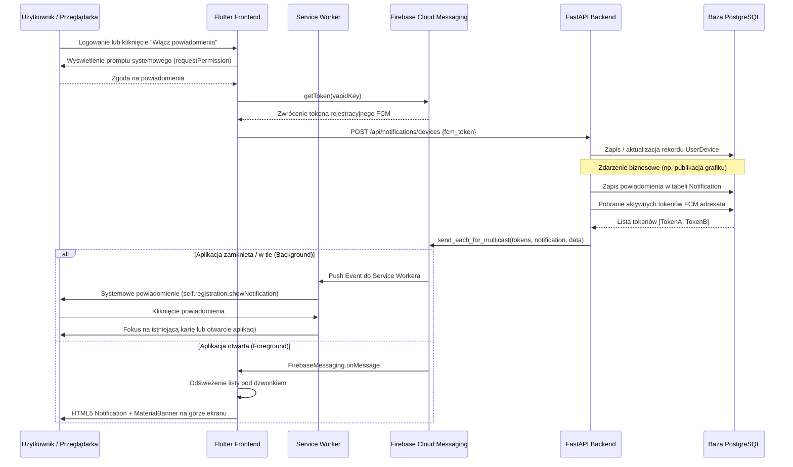

# Architektura Powiadomień Push (FCM & Web Push)

System PlannerV2 obsługuje wieloplatformowe powiadomienia Push za pośrednictwem Firebase Cloud Messaging (FCM) dla aplikacji mobilnych (Android, iOS) oraz przeglądarek internetowych (Web Push, w tym Progressive Web Apps na systemie iOS 16.4+).

---

## 1. Architektura i Komponenty

System składa się z trzech współpracujących warstw:

1. **Warstwa Kliencka (Flutter & Web Push Service Worker):**
   - Rejestracja urządzenia w usłudze FCM.
   - Obsługa powiadomień w tle przez dedykowany Service Worker przeglądarki (`firebase-messaging-sw.js`).
   - Obsługa powiadomień na pierwszym planie (Foreground) z podwójną sygnalizacją: natywnym powiadomieniem przeglądarki (HTML5 Notification API) oraz banerem systemowym u góry ekranu (`MaterialBanner`).
   - Zarządzanie uprawnieniami powiadomień w interfejsie (`NotificationBell`) z zachowaniem wymogu bezpośredniego gestu użytkownika (User Gesture) wymaganego przez przeglądarki Safari (iOS PWA) oraz Google Chrome.

2. **Warstwa Serwerowa (FastAPI Backend):**
   - Model `UserDevice` przechowujący relację 1:N między użytkownikiem a jego zarejestrowanymi tokenami urządzeń.
   - Rejestracja tokenów urządzeń pod endpointem `POST /api/notifications/devices`.
   - Wyrejestrowywanie tokenów pod `DELETE /api/notifications/devices/{token}` podczas wylogowania lub deaktywacji konta.
   - Serwis `PushService` (`backend/app/services/push_service.py`) wykorzystujący oficjalne SDK `firebase-admin` do asynchronicznej wysyłki komunikatów Multicast.

3. **Infrastruktura Sieciowa (Nginx Reverse Proxy):**
   - Serwowanie statycznych plików Service Workera (`/firebase-messaging-sw.js` oraz `/flutter_service_worker.js`) z nagłówkami `Cache-Control: no-cache, no-store, must-revalidate`.
   - Zapewnienie natychmiastowej propagacji aktualizacji kodu Service Workera do przeglądarek użytkowników.

---

## 2. Implementacja Web Push

### 2.1 Service Worker (`frontend/web/firebase-messaging-sw.js`)

Service worker działa w tle przeglądarki, niezależnie od tego, czy karta z aplikacją jest aktywna:

```javascript
importScripts("https://www.gstatic.com/firebasejs/10.7.0/firebase-app-compat.js");
importScripts("https://www.gstatic.com/firebasejs/10.7.0/firebase-messaging-compat.js");

firebase.initializeApp({
  apiKey: "...",
  appId: "...",
  messagingSenderId: "...",
  projectId: "planista-e31fe",
  authDomain: "planista-e31fe.firebaseapp.com",
  storageBucket: "planista-e31fe.firebasestorage.app",
});

const messaging = firebase.messaging();

messaging.onBackgroundMessage((payload) => {
  const notificationTitle = payload.notification?.title || payload.data?.title || 'Planista';
  const notificationOptions = {
    body: payload.notification?.body || payload.data?.body || '',
    icon: '/icons/Icon-192.png',
    badge: '/icons/Icon-192.png',
    data: payload.data || {},
  };

  return self.registration.showNotification(notificationTitle, notificationOptions);
});

self.addEventListener('notificationclick', (event) => {
  event.notification.close();
  event.waitUntil(
    clients.matchAll({ type: 'window', includeUncontrolled: true }).then((clientList) => {
      for (const client of clientList) {
        if ('focus' in client) {
          return client.focus();
        }
      }
      if (clients.openWindow) {
        return clients.openWindow('/');
      }
    })
  );
});
```

### 2.2 Integracja w Kodzie Flutter (`PushService` & `WebNotificationHelper`)

- **Konfiguracja klucza VAPID:**
  `PushService` pobiera klucz certyfikatu Web Push ze zmiennej środowiskowej kompilacji:
  ```dart
  static const String vapidKey = String.fromEnvironment('FCM_VAPID_KEY', defaultValue: '');
  ```
  Klucz jest opcjonalnie przekazywany do `_messaging.getToken(vapidKey: kIsWeb ? _resolvedVapidKey : null)`.

- **Izolacja platformowa (`WebNotificationHelper`):**
  Zastosowano architekturę warunkowych importów (`conditional imports`):
  - `web_notification_helper_web.dart`: implementacja korzystająca z `package:web` i `dart:js_interop` do obsługi `web.Notification`.
  - `web_notification_helper_stub.dart`: implementacja zastępcza dla środowisk mobilnych oraz testów jednostkowych na Dart VM.

- **Obsługa trybu pierwszoplanowego (Foreground):**
  Gdy użytkownik korzysta z otwartej aplikacji i nadejdzie powiadomienie:
  1. Lista powiadomień pod dzwoneczkiem odświeża się automatycznie (`ref.read(notificationsProvider.notifier).fetchNotifications()`).
  2. Wyświetlane jest powiadomienie przeglądarkowe (jeśli uprawnienia są przyznane).
  3. Wyświetlany jest widoczny baner u góry ekranu (`MaterialBanner` przez `rootScaffoldMessengerKey`).

---

## 3. Wsparcie Apple iOS Web Push (PWA)

Zgodnie ze standardami Apple (iOS 16.4+), obsługa Web Push w Safari wymaga:
1. Trybu pełnoekranowego Standalone PWA (`manifest.json` z `"display": "standalone"`).
2. Dodania witryny do ekranu początkowego urządzenia (Add to Home Screen).
3. Meta-tagu w `index.html`:
   ```html
   <meta name="apple-mobile-web-app-capable" content="yes">
   <meta name="apple-mobile-web-app-status-bar-style" content="black">
   <link rel="apple-touch-icon" href="icons/Icon-192.png">
   ```
4. Wywołania `Notification.requestPermission()` wyłącznie w bezpośredniej odpowiedzi na kliknięcie lub dotknięcie użytkownika (User Gesture). W aplikacji PlannerV2 zapewnia to przycisk „Włącz powiadomienia” umieszczony w oknie dialogowym `NotificationBell`.

---

## 4. Diagram Przepływu Danych



---

## 5. Bezpieczeństwo i Higiena Tokenów

- **Cykl życia tokena:** Tokeny są powiązane z konkretnym kontem użytkownika i jego sesją. Przy wylogowaniu aplikacja wywołuje `DELETE /api/notifications/devices/{token}`.
- **Deaktywacja konta:** Gdy menedżer dezaktywuje pracownika (`is_active = False`), powiązane urządzenia są usuwane, uniemożliwiając otrzymywanie poufnych powiadomień.
- **Obsługa nieważnych tokenów:** Gdy FCM zgłosi kod błędu `UnregisteredError` lub `InvalidArgumentError` dla danego tokena, backend automatycznie usuwa przestarzały rekord z bazy danych.
- **Nagłówki Nginx:** Pliki Service Workera nie podlegają buforowaniu przez przeglądarki ani serwery pośredniczące (`Cache-Control: no-cache, no-store, must-revalidate`), co zapobiega blokowaniu aktualizacji kodu push.
